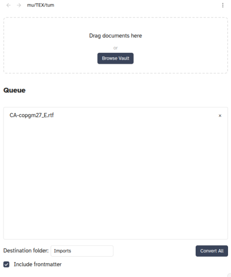
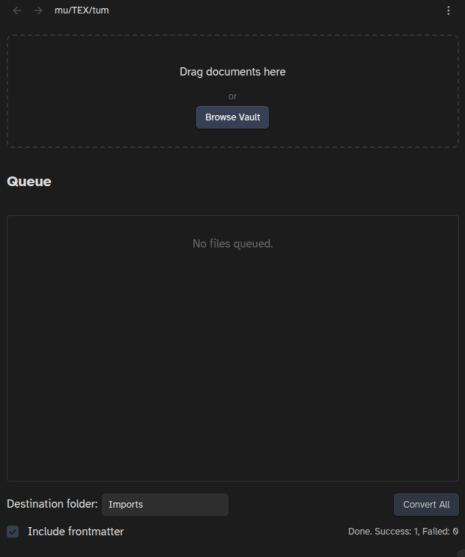

 

# mu/TEX/tum – Obsidian plugin

> **mutextum** (n.): That which has been changed by weaving — a document unwoven from its native form and rewoven as text. From Latin *mutare* ("to change") + *texere* ("to weave") + *-tum* (result).

A document converter for Obsidian. Import RTF, EPUB, CSV, Word, PowerPoint, Excel, OpenDocument, and PDF files and convert them to Markdown. *Mutare et notare* ("To change and note").

## Security and Privacy

See [the security and privacy notes](https://github.com/erykjj/mutextum?tab=security-ov-file) for information on what this plugin does and does not do behind the scenes.

---

## Features

- **Dedicated import panel** – Open the mu/TEX/tum panel from the ribbon or the command palette; drag documents in from anywhere on your computer, or browse files already in your vault
- **On-device conversion** – All conversion happens locally; no external services, no API keys, no network requests, no system dependencies
- **Broad format support** – Word (`.doc`, `.docx`), PowerPoint (`.ppt`, `.pptx`), Excel (`.xlsx`), OpenDocument (`.odt`, `.ods`, `.odp`), RTF (`.rtf`), EPUB (`.epub`), CSV (`.csv`), and PDF (`.pdf`)
- **Batch processing** – Queue multiple documents and convert them in one run, with a progress indicator and a per-file outcome summary
- **Multi-note mode** – Long documents are split into one note per top-level (`#`) heading, inside a subfolder named after the source file, with an index note listing all chapters; if no top-level headings are found, the document is written as a single note instead
- **Link cleanup** – Internal EPUB anchor links are removed; adjacent bold and italic spans left dangling by link removal are merged back into continuous formatting; *jw.org* links are stripped automatically, so [tra.VER:ture](https://github.com/erykjj/traverture) can handle scripture linking
- **Automatic conflict handling** – When a destination note or folder already exists, it is renamed with a numbered suffix (` 1`, ` 2`, …) rather than overwritten
- **Optional frontmatter** – Add YAML frontmatter to each generated note with source filename, conversion timestamp, and plugin version
- **Desktop and mobile support**

---

## Settings

- **Destination folder** – Where converted notes are written (default: `Imports`)
- **Include frontmatter** – Write YAML frontmatter in every generated note

The panel lets you change the destination folder and frontmatter toggle for the current session without touching these defaults.

---

## Known Limitations

- **PDFs with image-only pages** are not supported; these require optical character recognition; text-based PDFs convert normally
- **Some PDFs convert with garbled text.** The PDF's internal text layer is the problem, not the conversion; regenerating the PDF from its original source may produce clean output
- **Encrypted documents** cannot be converted
- **Multi-note splitting** is based on top-level (`#`) headings only; documents without any H1 headings are written as a single note, regardless of length
- **Output quality depends on the source.** Conversion preserves what the original document contains; poorly formatted sources, broken hyperlinks, or inconsistent styling in the original will be reflected in the converted Markdown (the converter cannot repair what was never structured correctly)

---

## Performance

Conversion is fast for typical documents, but very large files may take a moment. The source file remains untouched throughout.

---

## Installation & Updating

1. In your vault's `.obsidian/plugins/` directory, make a directory (folder) called `mutextum`, if you don't already have one
2. Download [main.js](https://github.com/erykjj/mutextum/releases/latest/download/main.js), [styles.css](https://github.com/erykjj/mutextum/releases/latest/download/styles.css) and [manifest.json](https://github.com/erykjj/mutextum/releases/latest/download/manifest.json) and put them in that directory (over-writing to update)
3. If not already enabled, enable *mu/TEX/tum* in Obsidian Settings → Community plugins

Files can be dragged into the panel from outside the vault, so there is no need to change Obsidian's file-visibility settings.

---

## Feedback, etc.

Feel free to get in touch and post any [issues and/or suggestions](https://github.com/erykjj/mutextum/issues)

My other Obsidian plugins:

- **con[VER]sum**: [GitHub repo](https://github.com/erykjj/conversum), [Obsidian Community](https://community.obsidian.md/plugins/conversum)
- **in(REF)ens**: [GitHub repo](https://github.com/erykjj/inrefens), [Obsidian Community](https://community.obsidian.md/plugins/inrefens)
- **tra.VER:ture**: [GitHub repo](https://github.com/erykjj/traverture), [Obsidian Community](https://community.obsidian.md/plugins/traverture)